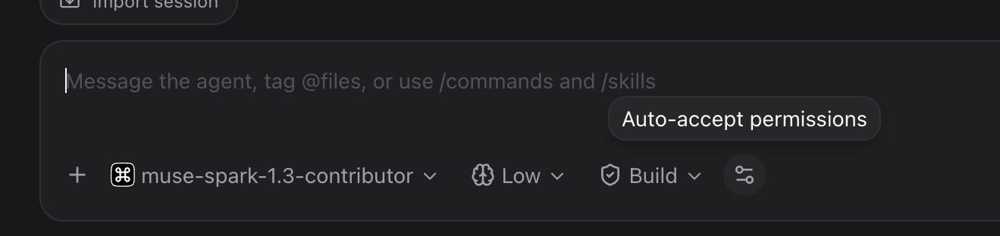
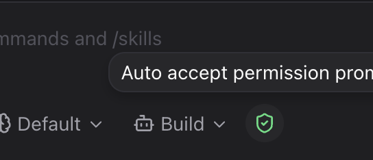

# paseo-commandcode-provider

A [Paseo](https://paseo.sh) provider plugin for [Command Code](https://commandcode.ai) (`commandcode` CLI). Requires Paseo `>=0.8.0` and `commandcode` on `PATH` (logged in via `commandcode login`) — on Windows the plugin looks for `cmdc` instead, since `commandcode` isn't guaranteed to have installed a `cmd` shim (that name is taken by the Windows shell).

To point at a different binary (a different alias, a full path, a wrapper script), either:
- Set it under **Settings → Plugins → Command Code**, or
- Set the `COMMANDCODE_CLI_COMMAND` environment variable for the Paseo daemon, which takes priority over the setting.

The binary must support `commandcode acp` (the Agent Client Protocol server).

## Screenshots




## Install

```bash
paseo plugin add npm:@alhassanaraouf/paseo-commandcode-provider
```

Or from GitHub:

```bash
paseo plugin add alhassanaraouf/paseo-commandcode-provider
```

Or from a local checkout:

```bash
paseo plugin add /path/to/paseo-commandcode-provider
```

Then create an agent with the **Command Code** provider.

## What works

The provider runs `commandcode acp` and talks to it over the [Agent Client Protocol](https://agentclientprotocol.com) using Paseo's ACP adapter, so most behaviour comes straight from the CLI:

- **Questions** — when the agent calls `ask_user_question`, the options show up as a prompt in Paseo and your choice goes back to the agent. Nothing is auto-answered.
- **Permissions** — file writes and shell commands ask first, with Allow once / Always allow / Reject / Always reject.
- **Modes** — the CLI's own permission modes: Standard (ask before changes), Accept Edits, Plan, Don't Ask, and Bypass Permissions.
- **Models and effort** — the CLI's live model list and per-model effort levels.
- **Messages, thinking, tool calls, usage and cost** streamed into the timeline. The Tasks pill follows the agent's `todo_write` checklist.
- **Images** are sent to the CLI directly (vision-capable models only).
- **Persistence** — sessions resume by native session id (`session/load`); existing CLI sessions are listed for import.
- **Slash commands** — everything the CLI advertises over ACP (`/compact`, installed skills, mod commands). ACP doesn't expose the CLI's built-in management commands, so the provider adds these; each runs a CLI subcommand and shows its output as a notice:
  - `/status`, `/info`, `/models`, `/mcp-list`
  - `/taste-list`, `/taste-learn [path|owner/repo]`
  - `/skills-list`, `/skills-add <owner/repo>`
  - `/mods-list`, `/mods-add <source>`
- Interrupt cancels the running turn. Sending a message while a turn runs interrupts it and starts the new one.

## Upgrading from 0.1.x

0.1.x drove `commandcode -p` with a single "Full auto (yolo)" toggle, which also made the CLI answer every question with its first option. That toggle is gone. Existing agents open in **Standard** mode; pick **Bypass Permissions** if you want the old full-auto behaviour. An effort of "Max" carries over as "Xhigh".

## Known issues

- The binary is chosen per Paseo daemon, not per agent: setting `COMMANDCODE_CLI_COMMAND` on a single agent no longer changes which binary it runs.
- Project-level mods aren't loaded: the CLI's ACP server only loads user mods (`~/.commandcode/mods`). 0.1.x loaded project mods only with yolo on.
- Interactive/TTY-only features (`/usage`, `/login`, `/connect`, IDE setup) aren't available — run them in a terminal.

## Develop

```bash
npm install
npm run typecheck
npm test
paseo plugin reload commandcode-provider
paseo plugin logs commandcode-provider
```
